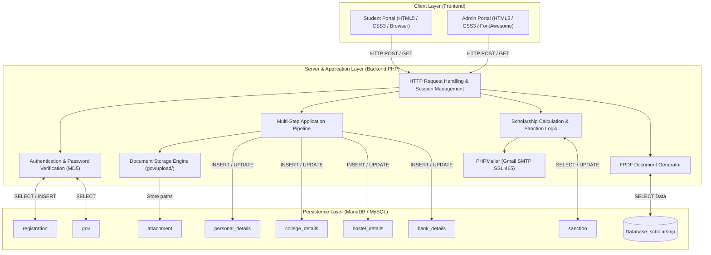
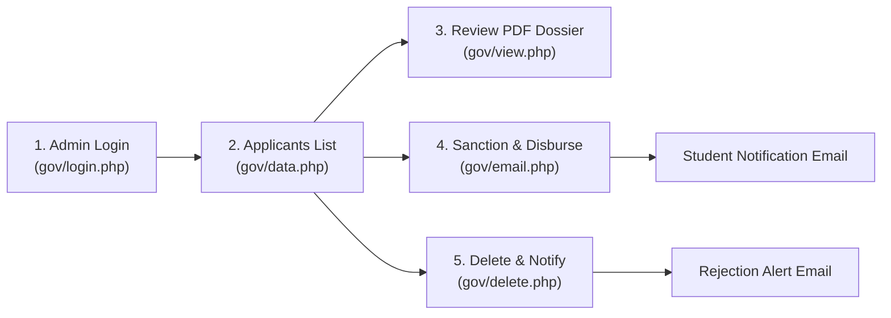

# Scholarship Tracking & Management System - Workflow Architecture

## Executive Overview
The **Scholarship Tracking & Management System** is an end-to-end web-based platform engineered to automate student scholarship applications, document verification, administrative appraisal, sanction disbursement calculation, and real-time status reporting. The application is bifurcated into two primary operational portals:
1. **Student Portal**: Self-service application intake, document uploads, live status tracking, and automated PDF acknowledgement generation.
2. **Government / Administrative Portal**: Centralized administrative dashboard for document inspection, eligibility validation, financial sanction calculation, and automated transactional email dispatch.

This directory contains the comprehensive, multi-layered workflow documentation covering the **Frontend**, **Backend**, **Database**, and **End-to-End System Integration**.

---

## Documentation Index

| Document | Focus Area | Description |
| :--- | :--- | :--- |
| **[`frontend_workflow.md`](./frontend_workflow.md)** | **Frontend Layer** | Client-side architecture, UI page hierarchy, multi-stage application wizard, form validation mechanics, preview interfaces, and state routing. |
| **[`backend_workflow.md`](./backend_workflow.md)** | **Backend Layer** | PHP request-response lifecycle, session state persistence, file upload handling, business rule engine (sanctions), PHPMailer SMTP email dispatch, and FPDF document rendering. |
| **[`database_workflow.md`](./database_workflow.md)** | **Database Layer** | Relational schema definition (MySQL/MariaDB), Entity-Relationship (ER) model, data dictionary, foreign key cascading constraints, and CRUD lifecycle. |
| **[`end_to_end_workflow.md`](./end_to_end_workflow.md)** | **Integration & Flow** | End-to-end Sequence Diagrams, Data Flow Diagrams (DFD Level 0, 1, 2), state machine models, edge case handling, and security enhancement recommendations. |

---

## High-Level System Architecture Diagram



---

## Core Operational Modules

### 1. Student Onboarding & Multi-Step Application Pipeline

```mermaid
graph LR
    Reg["1. Registration<br/>(registration.php)"] --> Log["2. Login<br/>(login.php)"]
    Log --> Dash["3. Student Dashboard<br/>(home.php)"]
    Dash --> Pers["4. Personal Details<br/>(personal.php)"]
    Pers -->|Hostel = Yes| Host["5. Hostel Details<br/>(hostel.php)"]
    Pers -->|Hostel = No| Coll["6. College Details<br/>(college.php)"]
    Host --> Coll
    Coll --> Bank["7. Bank Details<br/>(bank.php)"]
    Bank --> Doc["8. Attachment Uploads<br/>(attachment.php)"]
    Doc --> Prev["9. Preview Application<br/>(preview.php)"]
    Prev --> Ack["10. PDF Acknowledgement<br/>(acknowledgement.php)"]
```


### 2. Administrative Review & Sanction Pipeline


---

## File System & Project Layout
```text
Scholarship Tracking System/
├── Scholarship-Management-System/     # Application Source Code
│   ├── css/                           # Frontend stylesheets for student portal
│   │   └── style.css
│   ├── doc/                           # FPDF documentation library
│   ├── font/                          # FPDF core fonts
│   ├── gov/                           # Government & Administrative sub-system
│   │   ├── css/                       # Admin portal stylesheets
│   │   ├── phpmailer/                 # PHPMailer library files
│   │   ├── upload/                    # Applicant document upload repository
│   │   ├── connect.php                # Admin database connection handle
│   │   ├── data.php                   # Applicant listing & administrative console
│   │   ├── delete.php                 # Rejection & cascade deletion controller
│   │   ├── email.php                  # Acceptance, sanction calculation, & SMTP mailer
│   │   ├── fpdf.php                   # FPDF engine for admin view
│   │   ├── index.php                  # Government portal landing page
│   │   ├── login.php                  # Government admin authentication
│   │   └── view.php                   # Administrative application dossier generator
│   ├── connect.php                    # Student portal database connection handle
│   ├── registration.php               # Student account creation controller & view
│   ├── login.php                      # Student login controller & view
│   ├── home.php                       # Student dashboard
│   ├── personal.php                   # Step 1: Personal profile & hostel choice
│   ├── hostel.php                     # Step 2: Hostel information form
│   ├── college.php                    # Step 3: Academic & institution profile
│   ├── bank.php                       # Step 4: Banking details & account verification
│   ├── attachment.php                 # Step 5: Document uploads & file persistence
│   ├── preview.php                    # Step 6: Application summary & preview
│   ├── acknowledgement.php            # Step 7: FPDF application download
│   ├── scholarship_status.php         # Sanction status viewer
│   ├── fpdf.php                       # Core FPDF class file
│   └── scholarship (1).sql            # Complete database schema and seed data
└── workflow/                          # System Architecture & Detailed Workflow Specs
    ├── README.md                      # Master index & architectural summary
    ├── frontend_workflow.md           # Deep-dive Frontend workflow & UI architecture
    ├── backend_workflow.md            # Deep-dive Backend workflow & business logic
    ├── database_workflow.md           # Deep-dive Database schema, ERD & data flow
    └── end_to_end_workflow.md         # Comprehensive end-to-end integration & sequences
```
