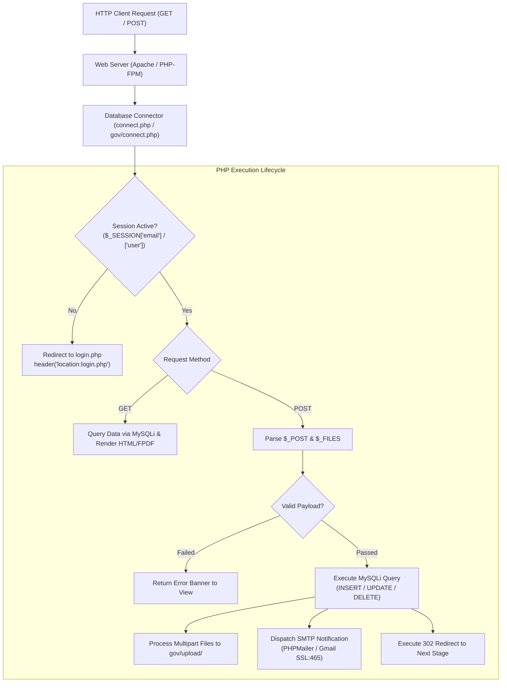
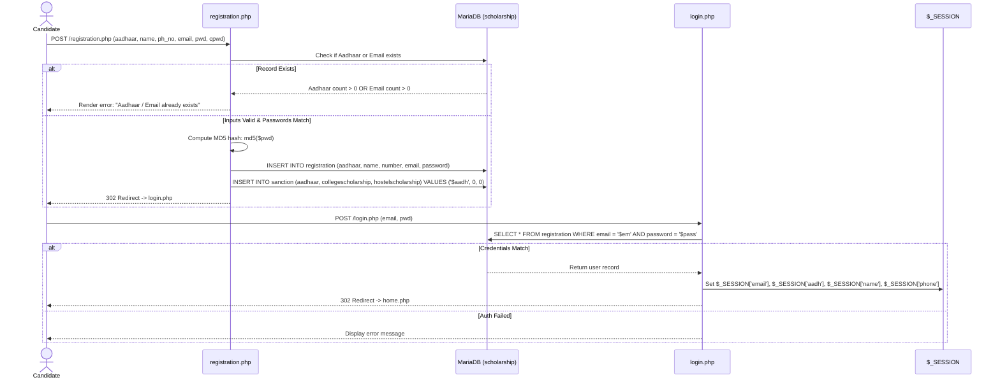
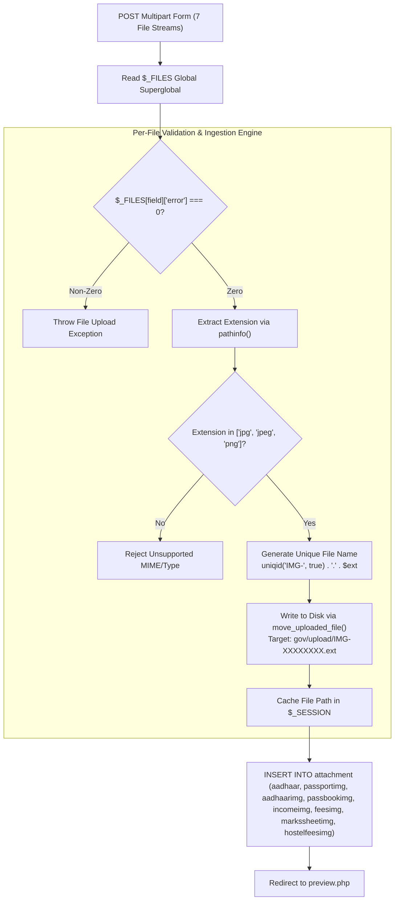
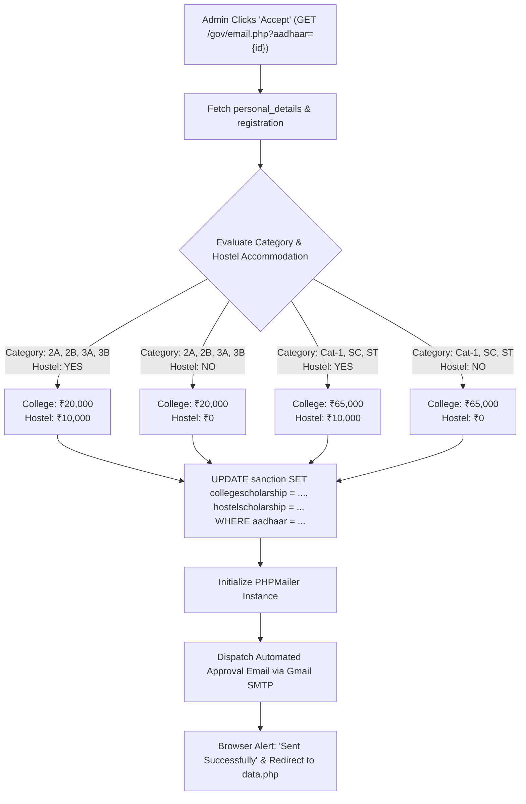

# Backend Workflow & Server Logic Architecture

## 1. Overview & Backend Technology Stack
The backend subsystem of the **Scholarship Tracking System** runs on **PHP 8.x** utilizing the procedural **MySQLi** extension for relational database interactions, native **PHP Sessions** for state continuity across HTTP requests, **PHPMailer** for encrypted SMTP transmission, and **FPDF** for runtime document compilation.

### Core Backend Responsibilities
1. **Authentication & Session Orchestration**: Gatekeeping protected endpoints, verifying MD5 credentials, managing student and administrator session lifetimes.
2. **Form Data Ingestion & Sanitization**: Parsing POST payloads across multi-step wizard stages and enforcing relational integrity constraints.
3. **Multipart File Processing Engine**: Validating uploaded file types, assigning cryptographic unique identifiers, and writing binaries to persistent disk storage (`gov/upload/`).
4. **Scholarship Sanction Business Rules Engine**: Evaluating applicant demographic criteria (category, economic status, hostel residency) to compute college and hostel scholarship allocations.
5. **Transactional Messaging Subsystem**: Automated email notifications via PHPMailer (authenticated SMTP over SSL on port 465) and native PHP `mail()`.
6. **Automated Document Synthesis**: Assembling relational student dossiers into standardized PDF certificates using FPDF.

---

## 2. Server Architecture & Request Lifecycle



---

## 3. Database Connection Architecture

Database connections are established via two dedicated configuration scripts:
1. `connect.php` (Root directory, utilized by Student Portal modules)
2. `gov/connect.php` (Administrative subfolder, utilized by Government Portal modules)

### Connection Parameters
```php
$ServerName = 'localhost';
$UserName   = 'root';
$Password   = '';
$dbName     = 'scholarship';  

$connect = mysqli_connect($ServerName, $UserName, $Password, $dbName);

if(!$connect) {
    echo "Connection failed";
}
```

> [!NOTE]
> Database operations throughout the codebase utilize procedural MySQLi functions: `mysqli_query()`, `mysqli_fetch_assoc()`, `mysqli_num_rows()`, and `mysqli_fetch_array()`.

---

## 4. Authentication, Registration, & Session Management



### Route Guarding Pattern
Every internal student script (`personal.php`, `college.php`, `bank.php`, `attachment.php`, `preview.php`, `scholarship_status.php`) enforces route protection using session verification:
```php
session_start();
if(empty($_SESSION['email'])) {         
    header("location:login.php"); 
    exit();
}
```

---

## 5. Document Ingestion & Storage Subsystem (`attachment.php`)

Candidate file uploads are streamed as binary payloads through `attachment.php` and persisted to the physical file system under `gov/upload/`.



---

## 6. Business Logic: Scholarship Sanctioning Engine (`gov/email.php`)

When an authorized government desk officer reviews an application in `gov/data.php` and triggers the **Accept (`fa fa-check`)** action, the backend invokes `gov/email.php`.

### Decision Matrix & Calculation Rules



### Sanction Rules Reference Table

| Category Code | Hostel Resident | Sanctioned Tuition (INR) | Sanctioned Hostel (INR) | Total Disbursement (INR) |
| :--- | :---: | :---: | :---: | :---: |
| **Category 2A / 2B / 3A / 3B** | Yes | ₹20,000 | ₹10,000 | **₹30,000** |
| **Category 2A / 2B / 3A / 3B** | No | ₹20,000 | ₹0 | **₹20,000** |
| **Category 1 / SC / ST** | Yes | ₹65,000 | ₹10,000 | **₹75,000** |
| **Category 1 / SC / ST** | No | ₹65,000 | ₹0 | **₹65,000** |

---

## 7. Email Notification Dispatch Architecture

The system utilizes **PHPMailer v6** via secure SMTP socket connections:

```php
use PHPMailer\PHPMailer\PHPMailer;
use PHPMailer\PHPMailer\Exception;

$mail = new PHPMailer(true);
$mail->isSMTP();
$mail->Host       = 'smtp.gmail.com';
$mail->SMTPAuth   = true;
$mail->Username   = 'omkarjavali1@gmail.com';
$mail->Password   = 'rcrcfnyoqdcyyfzo'; // Google App Password
$mail->SMTPSecure = 'ssl';
$mail->Port       = 465;

$mail->setFrom('omkarjavali1@gmail.com');
$mail->addAddress($result['email']);
$mail->Subject = "Scholarship Sanction Notification";
$mail->Body    = "Hello {$a['name']}, your scholarship has been sanctioned. Please check your scholarship status on the portal.";
$mail->send();
```

---

## 8. Administrative Cascade Deletion & Rejection Engine (`gov/delete.php`)

When an administrator rejects an incomplete or ineligible applicant:
1. Candidate email address is retrieved from `personal_details`.
2. A formal rejection email is transmitted notifying the student to reapply before the deadline.
3. Upon email delivery, the primary record in `personal_details` is deleted:
   ```sql
   DELETE FROM personal_details WHERE aadhaar = '$a[aadhaar]';
   ```
4. **Relational Cascade Mechanism**: Because the foreign keys in `college_details`, `hostel_details`, `bank_details`, and `attachment` specify `ON DELETE CASCADE`, the database engine automatically purges all connected child records atomically.
