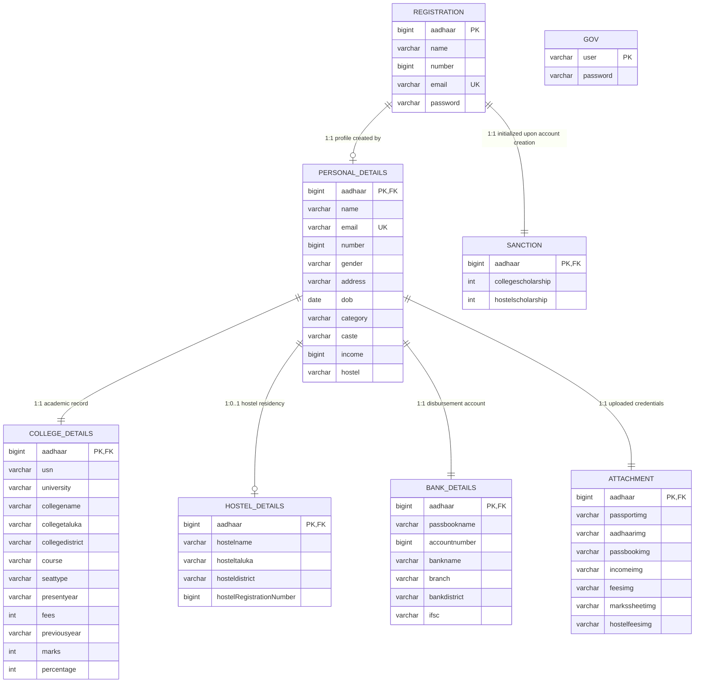
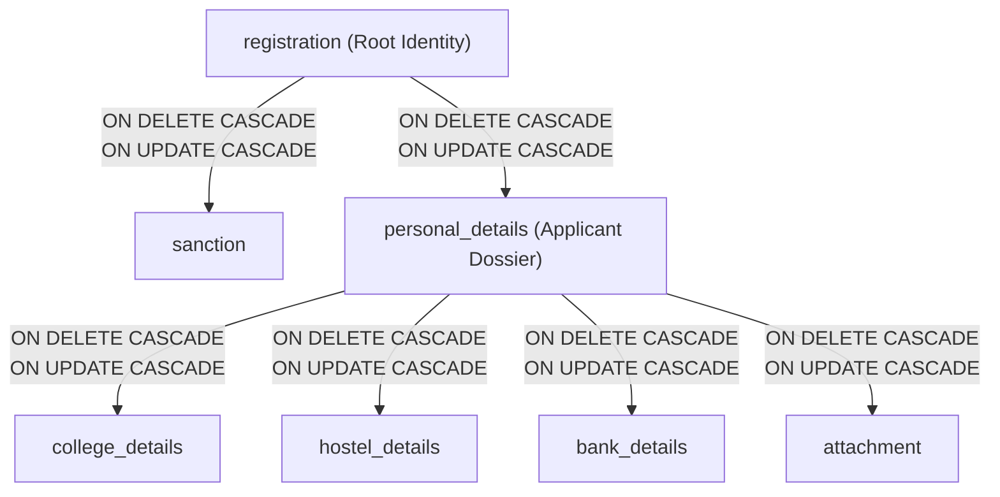

# Database Workflow & Data Persistence Architecture

## 1. Overview & Database Architecture
The **Scholarship Tracking System** relies on a relational schema deployed on **MariaDB / MySQL (InnoDB engine)** with `utf8mb4` character encoding. The persistence layer enforces strict referential integrity through foreign key constraints configured with cascading updates and deletions (`ON DELETE CASCADE ON UPDATE CASCADE`).

### Database Specifications
- **Database Name**: `scholarship`
- **Default Storage Engine**: `InnoDB`
- **Default Collation**: `utf8mb4_general_ci`
- **Primary Root Identifier**: `aadhaar` (`bigint(20)`) representing the applicant's 12-digit Indian Unique Identification Number.

---

## 2. Entity-Relationship Diagram (ERD)

---

## 3. Data Dictionary & Table Structures

### 3.1 Table: `registration`
The entry-point user registry storing authenticating student credentials.
| Column | Type | Null | Key | Default | Description |
| :--- | :--- | :---: | :---: | :---: | :--- |
| `aadhaar` | `bigint(20)` | NO | **PK** | *None* | 12-digit Aadhaar UID (Global Candidate Key) |
| `name` | `varchar(255)` | NO | | *None* | Full legal name as registered in identity records |
| `number` | `bigint(15)` | NO | | *None* | Contact telephone / mobile number |
| `email` | `varchar(255)` | NO | **UK** | *None* | Unique applicant email address (Login ID) |
| `password` | `varchar(255)` | NO | | *None* | MD5-hashed security passphrase |

### 3.2 Table: `personal_details`
Core candidate demographic and socio-economic profile.
| Column | Type | Null | Key | Default | Description |
| :--- | :--- | :---: | :---: | :---: | :--- |
| `aadhaar` | `bigint(20)` | NO | **PK, FK** | *None* | References `registration(aadhaar)` |
| `name` | `varchar(255)` | NO | | *None* | Legal applicant name |
| `email` | `varchar(255)` | NO | **UK** | *None* | Contact email address |
| `number` | `bigint(15)` | NO | | *None* | Contact phone number |
| `gender` | `varchar(255)` | NO | | *None* | Candidate gender (`male`, `female`, `other`) |
| `address` | `varchar(255)` | NO | | *None* | Residential permanent postal address |
| `dob` | `date` | NO | | *None* | Date of birth (YYYY-MM-DD) |
| `category` | `varchar(255)` | NO | | *None* | Reservation category (`cat1`, `cat2a`, `sc`, `st`, etc.) |
| `caste` | `varchar(255)` | NO | | *None* | Specific sub-caste designation |
| `income` | `bigint(10)` | NO | | *None* | Annual household gross income in INR |
| `hostel` | `varchar(255)` | NO | | *None* | Hostel accommodation flag (`yes` / `no`) |

### 3.3 Table: `college_details`
Institutional enrollment, academic background, and annual fee status.
| Column | Type | Null | Key | Default | Description |
| :--- | :--- | :---: | :---: | :---: | :--- |
| `aadhaar` | `bigint(20)` | NO | **PK, FK** | *None* | References `personal_details(aadhaar)` |
| `usn` | `varchar(255)` | NO | | *None* | University Seat Number / Enrolment ID |
| `university` | `varchar(255)` | NO | | *None* | Affiliated university or educational board |
| `collegename` | `varchar(255)` | NO | | *None* | Enrolled college / institution name |
| `collegetaluka` | `varchar(255)` | NO | | *None* | Administrative taluka of the institution |
| `collegedistrict` | `varchar(255)` | NO | | *None* | District of the educational institution |
| `course` | `varchar(255)` | NO | | *None* | Enrolled degree program (e.g., B.E., B.Sc) |
| `seattype` | `varchar(255)` | NO | | *None* | Admission quota (Government, Management, etc.) |
| `presentyear` | `varchar(255)` | NO | | *None* | Current year of study (`1`, `2`, `3`, `4`) |
| `fees` | `int(11)` | NO | | *None* | Institutional annual tuition fees paid |
| `previousyear` | `varchar(255)` | NO | | *None* | Prior academic year reference |
| `marks` | `int(11)` | NO | | *None* | Total marks achieved in previous qualifying exam |
| `percentage` | `int(11)` | NO | | *None* | Academic percentage earned |

### 3.4 Table: `hostel_details`
Hostel residency data for candidates opting for boarding assistance.
| Column | Type | Null | Key | Default | Description |
| :--- | :--- | :---: | :---: | :---: | :--- |
| `aadhaar` | `bigint(20)` | NO | **PK, FK** | *None* | References `personal_details(aadhaar)` |
| `hostelname` | `varchar(255)` | NO | | *None* | Official hostel facility name |
| `hosteltaluka` | `varchar(255)` | NO | | *None* | Taluka location of the hostel |
| `hosteldistrict` | `varchar(255)` | NO | | *None* | District location of the hostel |
| `hostelRegistrationNumber`| `bigint(20)` | NO | | *None* | Official hostel license / room registration number |

### 3.5 Table: `bank_details`
Direct Benefit Transfer (DBT) banking credentials for disbursement.
| Column | Type | Null | Key | Default | Description |
| :--- | :--- | :---: | :---: | :---: | :--- |
| `aadhaar` | `bigint(20)` | NO | **PK, FK** | *None* | References `personal_details(aadhaar)` |
| `passbookname` | `varchar(255)` | NO | | *None* | Candidate name as printed on bank passbook |
| `accountnumber`| `bigint(20)` | NO | | *None* | Commercial bank account number |
| `bankname` | `varchar(255)` | NO | | *None* | Banking corporation name |
| `branch` | `varchar(255)` | NO | | *None* | Home branch location |
| `bankdistrict` | `varchar(255)` | NO | | *None* | Bank branch district |
| `ifsc` | `varchar(255)` | NO | | *None* | 11-character Indian Financial System Code |

### 3.6 Table: `attachment`
File path pointers referencing documents stored on the server disk (`gov/upload/`).
| Column | Type | Null | Key | Default | Description |
| :--- | :--- | :---: | :---: | :---: | :--- |
| `aadhaar` | `bigint(20)` | NO | **PK, FK** | *None* | References `personal_details(aadhaar)` |
| `passportimg` | `varchar(255)` | NO | | *None* | File path to passport photograph |
| `aadhaarimg` | `varchar(255)` | NO | | *None* | File path to scanned Aadhaar card |
| `passbookimg` | `varchar(255)` | NO | | *None* | File path to scanned bank passbook |
| `incomeimg` | `varchar(255)` | NO | | *None* | File path to scanned caste/income certificate |
| `feesimg` | `varchar(255)` | NO | | *None* | File path to admission fee receipt |
| `markssheetimg`| `varchar(255)` | NO | | *None* | File path to academic marksheet |
| `hostelfeesimg`| `varchar(255)` | NO | | *None* | File path to hostel fee receipt |

### 3.7 Table: `sanction`
Disbursement record updated by the government approval engine.
| Column | Type | Null | Key | Default | Description |
| :--- | :--- | :---: | :---: | :---: | :--- |
| `aadhaar` | `bigint(20)` | NO | **PK, FK** | *None* | References `registration(aadhaar)` |
| `collegescholarship` | `int(10)` | NO | | `0` | Sanctioned college tuition grant in INR |
| `hostelscholarship` | `int(10)` | NO | | `0` | Sanctioned hostel allowance grant in INR |

### 3.8 Table: `gov`
Back-office administrator credentials.
| Column | Type | Null | Key | Default | Description |
| :--- | :--- | :---: | :---: | :---: | :--- |
| `user` | `varchar(255)` | NO | **PK** | *None* | Administrative username |
| `password` | `varchar(255)` | NO | | *None* | Administrative password |

---

## 4. Referential Integrity & Cascade Architecture

The schema implements a two-tier cascading deletion hierarchy that prevents orphaned records:

### Cascade Behavior Scenarios:
1. **Government Rejection Triggered (`gov/delete.php`)**:
   - Query: `DELETE FROM personal_details WHERE aadhaar = '...'`
   - **Cascade Result**: `college_details`, `hostel_details`, `bank_details`, and `attachment` rows are automatically deleted. The candidate's `registration` account and `sanction` baseline remain intact, allowing the student to re-apply with corrected data.
2. **Account Deletion Triggered (Root Purge)**:
   - Query: `DELETE FROM registration WHERE aadhaar = '...'`
   - **Cascade Result**: Completely wipes out all applicant records across all 6 connected tables in a single transaction.

---

## 5. CRUD Operations & PHP Script Mapping Matrix

| Script | Table Involved | Operation | SQL Query Pattern |
| :--- | :--- | :---: | :--- |
| `registration.php` | `registration` | `SELECT` | `SELECT * FROM registration WHERE aadhaar = '$aadh' OR email = '$em'` |
| `registration.php` | `registration` | `INSERT` | `INSERT INTO registration (aadhaar, name, number, email, password) VALUES (...)` |
| `registration.php` | `sanction` | `INSERT` | `INSERT INTO sanction (aadhaar, collegescholarship, hostelscholarship) VALUES ('$aadh', 0, 0)` |
| `login.php` | `registration` | `SELECT` | `SELECT * FROM registration WHERE email = '$em' AND password = '$pass'` |
| `personal.php` | `personal_details` | `SELECT` / `INSERT` | Check existence and `INSERT INTO personal_details VALUES (...)` |
| `hostel.php` | `hostel_details` | `SELECT` / `INSERT` | Check existence and `INSERT INTO hostel_details VALUES (...)` |
| `college.php` | `college_details` | `SELECT` / `INSERT` | Check existence and `INSERT INTO college_details VALUES (...)` |
| `bank.php` | `bank_details` | `SELECT` / `INSERT` | Check existence and `INSERT INTO bank_details VALUES (...)` |
| `attachment.php` | `attachment` | `SELECT` / `INSERT` | Check existence and `INSERT INTO attachment VALUES (...)` |
| `preview.php` | All Tables | `SELECT` | Fetch joined applicant records for visual validation |
| `acknowledgement.php`| `personal_details`, `college_details`, `hostel_details` | `SELECT` | Read records to populate FPDF printout |
| `scholarship_status.php`| `sanction` | `SELECT` | `SELECT * FROM sanction WHERE aadhaar = '$aa'` |
| `gov/login.php` | `gov` | `SELECT` | `SELECT * FROM gov WHERE user = '$u' AND password = '$pass'` |
| `gov/data.php` | `personal_details` | `SELECT` | `SELECT * FROM personal_details` |
| `gov/view.php` | All Tables | `SELECT` | Retrieve student dossier & file links for administrative PDF |
| `gov/email.php` | `personal_details`, `sanction` | `SELECT` / `UPDATE` | `UPDATE sanction SET collegescholarship = '...', hostelscholarship = '...' WHERE aadhaar = '...'` |
| `gov/delete.php` | `personal_details` | `SELECT` / `DELETE` | `DELETE FROM personal_details WHERE aadhaar = '$a[aadhaar]'` (Triggers cascade) |
