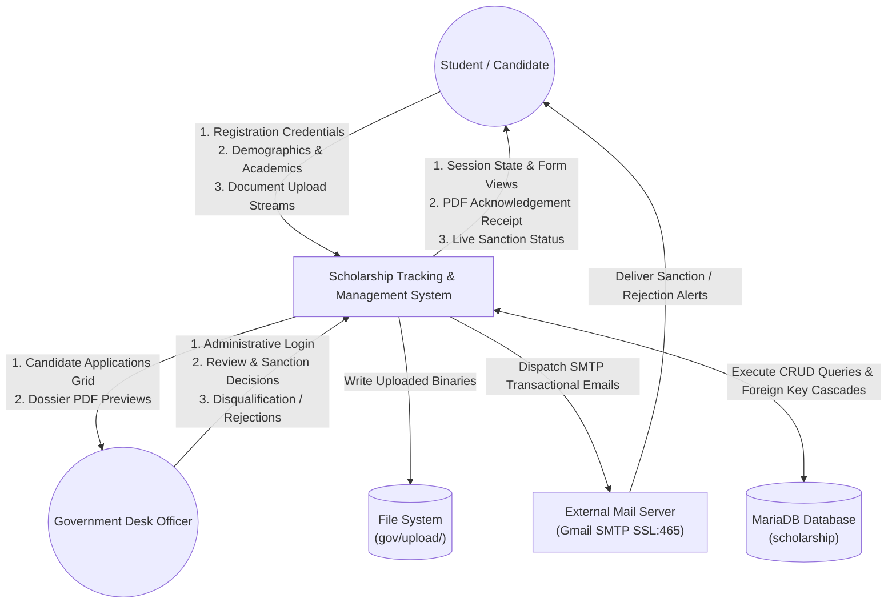
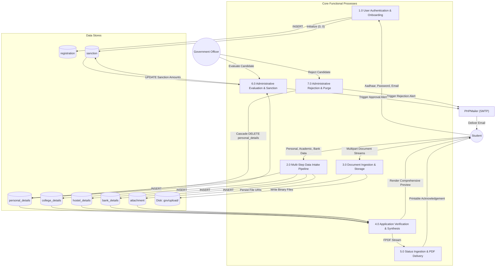
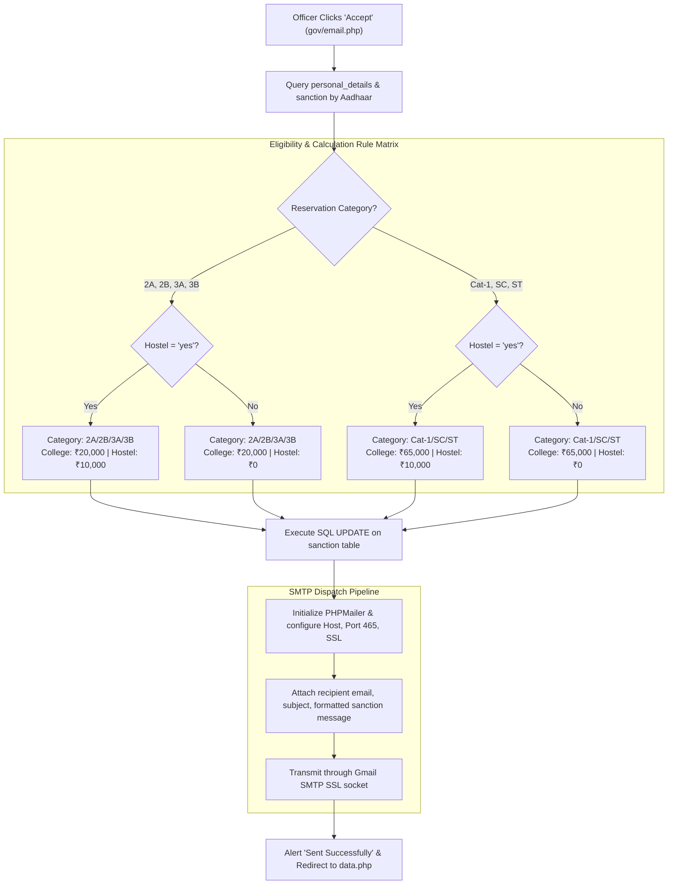
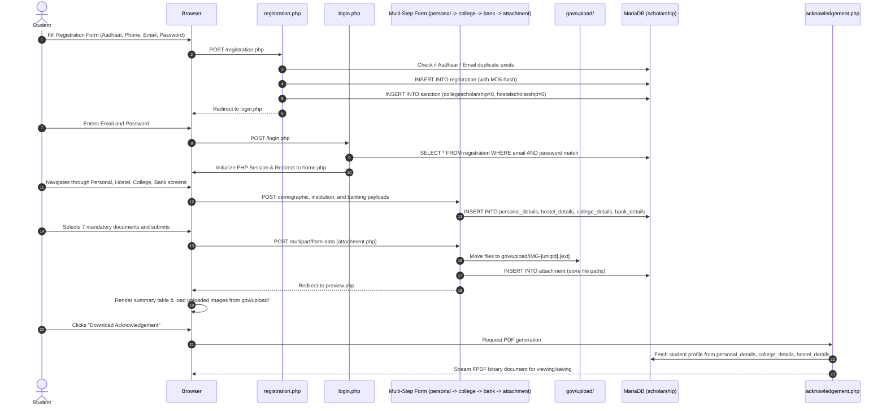
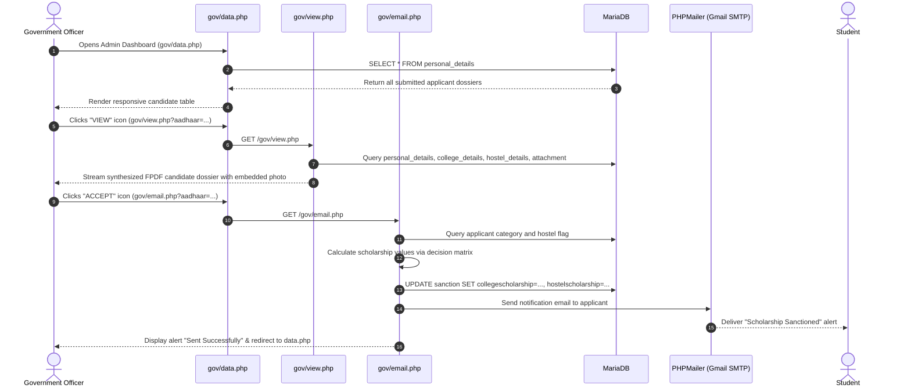
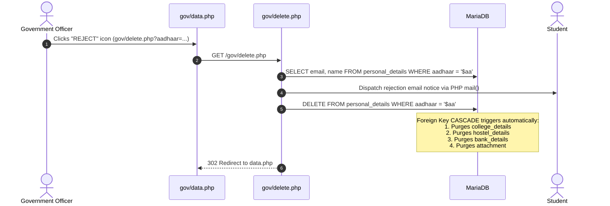
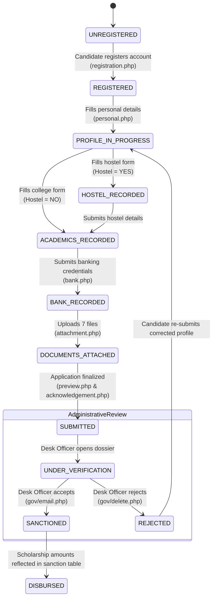

# End-to-End System Integration & Data Flow Architecture

## 1. System Integration Overview
The **Scholarship Tracking System** integrates client-side browser forms, server-side PHP business logic, physical disk storage, an authenticated external SMTP gateway (Google Mail), and a MariaDB relational database.

This document traces the complete end-to-end data pipelines, architectural sequence diagrams, Data Flow Diagrams (DFD Levels 0, 1, and 2), lifecycle state machines, and key system security considerations.

---

## 2. Data Flow Diagrams (DFD)

### 2.1 DFD Level 0 (Context Diagram)
The Context Diagram establishes the operational boundary of the system, illustrating interactions between external actors and the central software system.



---

### 2.2 DFD Level 1 (Decomposed Functional Processes)



---

### 2.3 DFD Level 2 (Sanction & Email Dispatch Engine)



---

## 3. Comprehensive Sequence Diagrams

### 3.1 End-to-End Student Application Lifecycle



---

### 3.2 Administrative Review, Sanction, and Automated Disbursement Pipeline



---

### 3.3 Administrative Candidate Rejection & Cascading Database Purge



---

## 4. Application Lifecycle State Machine



---

## 5. Security & Architectural Enhancements

While functional, several legacy patterns in the implementation can be fortified for production enterprise deployments:

### 5.1 SQL Injection Prevention
- **Current Pattern**: Direct string interpolation in procedural SQL queries:
  ```php
  $query = "SELECT * FROM `registration` where email = '$em' and password = '$pass'";
  ```
- **Recommended Hardening**: Implement parameterized prepared statements via PDO or MySQLi:
  ```php
  $stmt = $connect->prepare("SELECT * FROM registration WHERE email = ?");
  $stmt->bind_param("s", $email);
  $stmt->execute();
  $result = $stmt->get_result();
  ```

### 5.2 Password Storage Cryptography
- **Current Pattern**: MD5 hashing (`md5($_POST['pwd'])`), vulnerable to pre-computed rainbow table attacks.
- **Recommended Hardening**: Migrate to native PHP password hashing utilizing **BCRYPT** or **Argon2id**:
  ```php
  $hashedPassword = password_hash($rawPassword, PASSWORD_BCRYPT, ['cost' => 12]);
  // Verification:
  if (password_verify($enteredPassword, $hashedPassword)) { /* Validated */ }
  ```

### 5.3 File Upload Armor
- **Current Pattern**: Only checks file extension strings (`pathinfo()`).
- **Recommended Hardening**:
  1. Inspect MIME magic bytes via `finfo_file(finfo_open(FILEINFO_MIME_TYPE), $tmp_path)`.
  2. Block execution in the upload folder by configuring `.htaccess`:
     ```apache
     <FilesMatch "\.(php|phtml|php3|php4|php5|pl|py|cgi)$">
         Deny from all
     </FilesMatch>
     ```
  3. Enforce maximum file size bounds (e.g., 2MB).

### 5.4 Credential & Secret Isolation
- **Current Pattern**: Hardcoded Google App Passwords and database credentials in source files.
- **Recommended Hardening**: Extract secrets into an ignored `.env` file using a loader like `vlucas/phpdotenv`.
