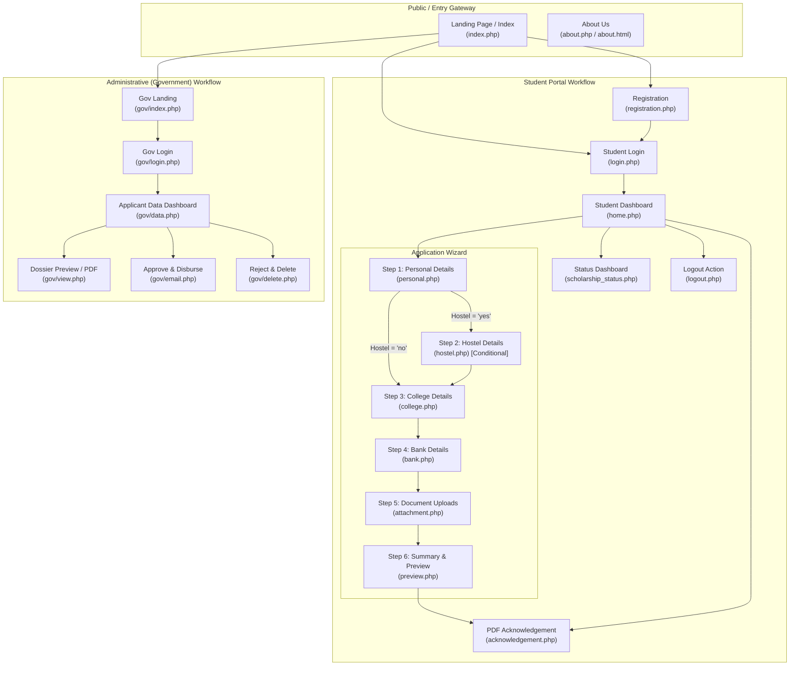
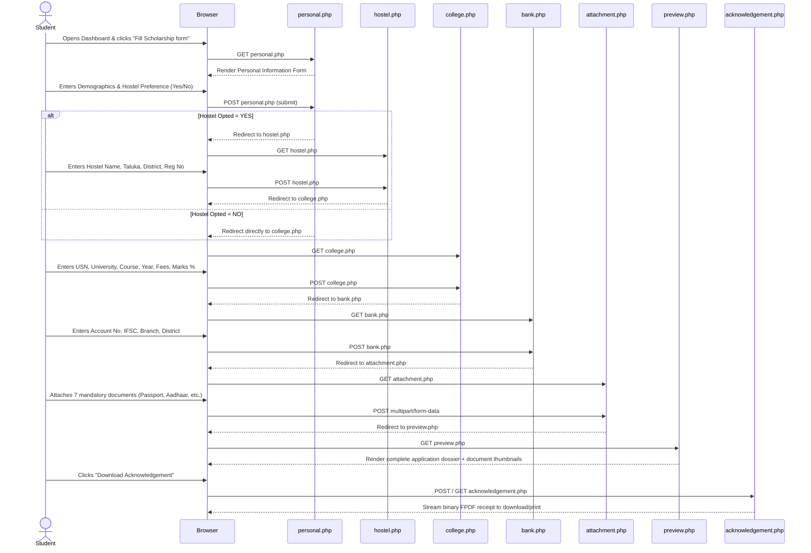

# Frontend Workflow & User Interface Architecture

## 1. Overview & UI Technology Stack
The frontend layer of the **Scholarship Tracking System** is built using native **HTML5**, **CSS3**, and **Vanilla JavaScript** (form validation patterns and event dispatchers), augmented with **FontAwesome** icon sets.

The system is architected into two isolated client interfaces:
1. **Student Self-Service Portal**: A multi-step application pipeline that guides candidates through registration, authentication, data submission across 5 form stages, document previews, and status tracking.
2. **Administrative Government Portal**: A back-office console for application verification, student record inspection, financial sanction dispatch, and candidate disqualification.

---

## 2. Page Hierarchy & Navigation Map

---

## 3. Student Portal Multi-Stage Application Wizard

The application submission process is structured as a sequential, multi-page wizard. Each stage submits a `POST` request to the backend, validates user input, persists data, and executes an automated redirect to the subsequent stage.

---

## 4. UI Screen Specifications & Validation Rules

### 4.1 Registration Screen (`registration.php`)
- **Visual Design**: Centered glassmorphic/bordered card layout with dual action buttons and navigation header.
- **Form Controls & Constraints**:
  - `aadhaar`: Type `text`, `minlength="12"`, `maxlength="12"`, `required`.
  - `name`: Type `text`, placeholder "Enter Name as per Aadhaar", `required`.
  - `ph_no`: Type `text`, placeholder "Enter Phone Number", `required`.
  - `email`: Type `email`, placeholder "Enter Email", `required`.
  - `pwd`: Type `password`, `minlength="8"`, `pattern="(?=.*\d)(?=.*[a-z])(?=.*[A-Z]).{8,}"` (enforces at least 1 number, 1 lowercase, 1 uppercase character, min 8 characters).
  - `cpwd`: Type `password`, confirmation field.
- **Client Alerts & Feedback Elements**:
  - `div.message1`: Dynamic inline warning text rendered when Aadhaar or Email duplicates exist, or passwords fail equality comparison.

### 4.2 Login Screen (`login.php`)
- **Controls**:
  - `email`: Type `email`, `required`.
  - `pwd`: Type `password`, `required`.
  - `submit`: Primary call-to-action button.
- **Error Feedback**:
  - Conditional banner rendered if database lookup yields no active credentials.
- **Footer Shortcut**: Deep-link to `registration.php` for unregistered students.

### 4.3 Student Dashboard (`home.php`)
- **Design Elements**: Three interactive circle cards representing key milestones:
  1. **Card 1: Fill Scholarship form**: Directs to `personal.php`.
  2. **Card 2: Scholarship Status**: Directs to `scholarship_status.php`.
  3. **Card 3: Acknowledgement**: Directs to `acknowledgement.php`.
- **Navigation Bar**: Brand logo, "About" link, and session-clearing "Logout" link.

### 4.4 Form Step 1: Personal Details (`personal.php`)
- **Auto-Fill Logic**: Pre-populates `aadhaar`, `name`, `email`, and `phone` from active session variables (`$_SESSION["aadh"]`, `$_SESSION["email"]`, etc.).
- **User Inputs**:
  - `addr`: Multi-line text address.
  - `gender`: Dropdown selector (`Male`, `Female`, `Other`).
  - `dob`: Date picker (`input type="date"`).
  - `cat`: Reservation Category (`cat1`, `cat2a`, `cat2b`, `cat3a`, `cat3b`, `sc`, `st`).
  - `caste`: Text field for specific sub-caste name.
  - `income`: Number input representing annual family income.
  - `hostel`: Radio buttons (`yes` / `no`).
- **Conditional Routing**:
  - Selecting `yes` sets route to `hostel.php`.
  - Selecting `no` redirects immediately to `college.php`.

### 4.5 Form Step 2: Hostel Details (`hostel.php`)
- **Encounter Condition**: Only accessible if candidate opts into hostel accommodation in Step 1.
- **Fields**:
  - `hname`: Hostel Name.
  - `htaluka`: Taluka / Subdivision.
  - `hdistrict`: District of hostel premises.
  - `hno`: Official Hostel Registration Number.
- **Forward Action**: "Next" button commits data and advances to `college.php`.

### 4.6 Form Step 3: College Details (`college.php`)
- **Fields Captured**:
  - `usn`: University Seat Number / Student Registration ID (unique check enforced).
  - `university`: Enrolling University / Board.
  - `collegename`: Institution Name.
  - `collegetaluka` & `collegedistrict`: Institutional location fields.
  - `course`: Enrolled academic branch (e.g., B.E., B.Tech, B.Sc, M.Tech).
  - `seattype`: Quota allocation (`Government`, `Management`, `SNQ`, `Payment`).
  - `year`: Current academic year of study (`1`, `2`, `3`, `4`).
  - `fees`: Annual tuition fees paid.
  - `pyear`: Prior academic year.
  - `marks` & `percentage`: Prior academic performance metrics.

### 4.7 Form Step 4: Bank Details (`bank.php`)
- **Security Check**:
  - Double-entry verification on bank account number: `accnumber` vs `acnumber`.
  - If inputs do not match character-for-character, form returns error state: `"account number must be same"`.
- **Fields**:
  - `passbookname`: Name as inscribed in official bank passbook.
  - `accnumber`: Bank account number.
  - `acnumber`: Confirm bank account number.
  - `bname`: Banking institution name (e.g., SBI, Canara Bank, HDFC).
  - `branch`: Branch name.
  - `bdistrict`: Bank branch district.
  - `ifsc`: Indian Financial System Code (IFSC).

### 4.8 Form Step 5: Document Uploads (`attachment.php`)
- **Form EncType**: `multipart/form-data` required for binary file streaming.
- **Uploaded Artifacts**:
  1. `passport`: Candidate passport size photograph.
  2. `aadh`: Scanned copy of Aadhaar card.
  3. `passbook`: Scanned copy of front page of bank passbook.
  4. `income`: Scanned caste / income certificate.
  5. `fees`: College admission fee receipt.
  6. `marksheet`: Marksheet of qualifying examination.
  7. `hostelfees`: Hostel fee receipt (optional if day scholar).
- **Supported MIME / Extensions**: Enforced on server-side as `jpg`, `jpeg`, `png`.

### 4.9 Form Step 6: Application Summary & Verification (`preview.php`)
- **Summary Visualizer**:
  - Tabular layout rendering all captured text data grouped logically: Demographics, Academic Info, Hostel Details, Bank Accounts.
  - Embedded image preview cells (``) verifying uploaded documents.
- **CTA**: "Download Acknowledgement" triggers the FPDF rendering engine.

### 4.10 Acknowledgement Receipt (`acknowledgement.php`)
- **Presentation**: Direct browser PDF streaming (`application/pdf`) generated via FPDF.
- **Content**: Official Government of Karnataka header, candidate dossier table, and transaction verification stamp.

---

## 5. Administrative (Government) Portal Frontend

### 5.1 Government Login (`gov/login.php`)
- Secure authentication screen for government desk officers and scholarship approvers.
- Validates against `gov` administrator accounts.

### 5.2 Officer Dashboard & Application Grid (`gov/data.php`)
- **Interactive Responsive Data Table**:
  - Columns: Aadhaar Number, Candidate Name, Contact Phone, Email Address, Administrative Options.
  - Action Glyphs (FontAwesome):
    - **View (`fa fa-file-pdf-o`)**: Launches `gov/view.php?aadhaar={id}` to generate a full PDF dossier including photograph.
    - **Accept (`fa fa-check`)**: Directs to `gov/email.php?aadhaar={id}` to execute scholarship sanction algorithm and email candidate.
    - **Reject (`fa fa-trash`)**: Directs to `gov/delete.php?aadhaar={id}` to purge application and notify applicant.
